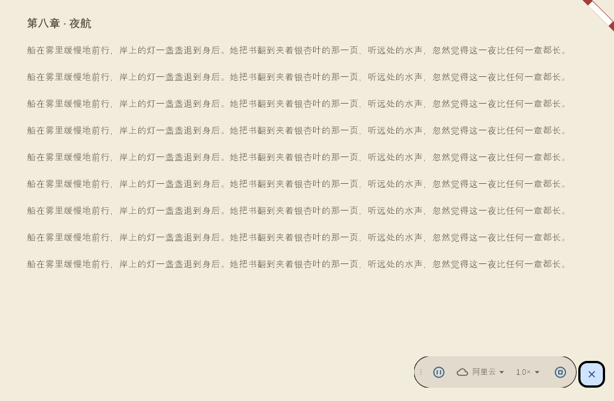
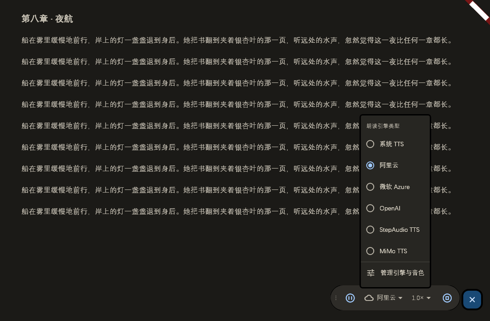
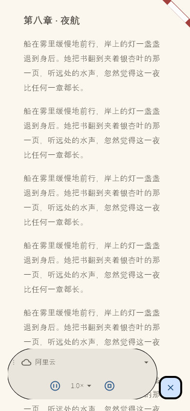

# 朗读悬浮播放器：自由拖动 + TTS 引擎下拉切换 — 设计规格

日期：2026-11-05
分支：`local/upstream-sync`
状态：已确认（用户需求已澄清；Lead 定稿设计方向，2026-11-05 逐条拍板 §14 六项决策，实现已同步落地）
关联：`2026-11-03-tts-fab-rate-design.md`（现行倍速快捷栏）、`2026-11-03-reading-panel-position-design.md`（浮动控件与面板位置）

用户原话：

> 朗读时右侧出现的悬浮框我需要能自由拖动；该悬浮框中新增下拉框，展现 TTS 引擎供选择切换播放。当前悬浮框展现布局样式，请帮我规划设计，确保操作方便，且能跟当前多端能完全兼容。

需求拆解：

1. 朗读中的迷你播放条（`lib/widgets/reading_page/tts_fab.dart`，由 `reading_chrome.dart` 在底部工具栏隐藏时展示）整卡可自由拖动，位置持久化。
2. 悬浮条内新增 TTS 引擎下拉，列出全部引擎并可在朗读过程中切换，切换后从当前句继续。
3. 重新规划悬浮条的形态、布局与操作层级，桌面 / 移动 / 平板横屏 / 鸿蒙 / Web 全端一致可用。

## 1. 目标

- 一个可拖动、可隐藏、不打断阅读的朗读仪表：默认右下角，拖动到任意位置后记住；旋转、缩放窗口、分屏、软键盘、安全区变化后仍在可视区。
- 展开后同时完成「暂停 / 继续」「切换引擎」「调倍速」「停止」四件事，不依赖打开完整朗读面板。
- 引擎切换有明确的过程反馈与失败出口，失败可直达「管理引擎与音色」。
- 布局在 320dp 手机、平板横屏、桌面宽窗口、Web 窗口、字体放大 2.0×、RTL、e-ink、减弱动画下均不溢出、不丢操作。

## 2. 范围

### 2.1 包含

- 重写 `lib/widgets/reading_page/tts_fab.dart`：自定位、拖动、响应式布局、引擎下拉、切换/错误反馈。
- 新增 `lib/widgets/reading_page/tts_fab_position.dart`：归一化锚点纯逻辑模型。
- 新增 `lib/widgets/reading_page/tts_engine_menu.dart`：引擎下拉按钮与菜单。
- 新增 `lib/widgets/reading_page/tts_engine_sheet.dart`：阅读页共用的「管理引擎与音色」底部弹层入口。
- `lib/widgets/reading_page/reading_chrome.dart`：改为整舞台 `Positioned.fill` 承载自定位的 `TtsFab`，并套用阅读主题。
- `Prefs` 新增 `ttsFabAnchorX` / `ttsFabAnchorY`（`double ∈ [0,1]`，默认 `1.0`，本地偏好）。
- ARB 新增少量文案并重新生成 l10n。
- 单元测试、Widget 测试、多端实机走查与回归。

### 2.2 不包含

- 不改变完整朗读面板 `tts_widget.dart` 的信息架构、滑块、定时停止与上/下句按钮；悬浮条只做高频四件事。
- 不新增引擎、不改引擎协议/密钥配置/音色解析，不改变 `TtsHandler.switchTtsType` 的游标迁移语义。
- 不改变六档倍速档位（`0.6 / 1.0 / 1.5 / 1.6 / 1.8 / 2.0`）与其持久化路径。
- 不做位置云同步、不在设置页新增「悬浮条位置」开关；不与 AI/笔记/样式面板位置共享偏好键。
- 不做吸附、网格、多播放器实例、拖到屏幕外的最小化成「边缘书签」等扩展形态。
- 不改阅读页翻页算法、不加全局快捷键、不引入新的第三方依赖（沿用 `pointer_interceptor`、`iconsx_plus`、Material `MenuAnchor`）。

## 3. 设计概念与原则

**概念：书签式朗读仪表。** 它是阅读页上的一枚安静悬浮乐器：默认贴在右下角页边，像一枚夹在书页上的书签；需要时展开成一条完整的控制台，不需要时缩回一枚圆形按钮。它不抢夺阅读的视觉中心，不与正文争夺颜色。

四条原则：

1. **安静表面。** 表面只用 `surfaceContainerHigh`，发丝描边 `outlineVariant`，阴影低调（`AppElevation.low` 量级）。禁止渐变、禁止第二强调色。
2. **单一强调色。** 只有「播放/暂停主操作」与「菜单选中项」使用 `colorScheme.primary` / `primaryContainer`；其余图标、文字、握柄全部为中性色（`onSurface` / `onSurfaceVariant`）。
3. **克制动效。** 展开/收起 150ms 横向揭示，淡入淡出 200ms，拖动时轻微抬升；不弹跳、不循环、不扫光；`disableAnimations` 与 e-ink 下一律瞬时。
4. **不打扰阅读。** 播放器只在自身区域命中指针，不覆盖整屏、不消费翻页手势；底部工具栏出现时让位（整件从树中移除）。

## 4. 结构：文件职责与挂载关系

| 单元 | 文件 | 职责 |
|---|---|---|
| `TtsFab` | `lib/widgets/reading_page/tts_fab.dart` | 宿主状态：播放相位派生、可见性、展开/收起、拖动手势、舞台计算、布局切换、错误反馈；仅通过 `TtsFabController` 访问播放服务 |
| `TtsFabController` | 同上 | UI 与播放服务之间的缝：`playbackState`（`ValueListenable<TtsPlaybackState>`）、`rate`、`serviceId`、`play/pause/stop/retry/switchEngine/setRate`；生产实现委托 `TtsHandler` 单例，测试注入 Fake |
| `TtsFabAnchor` | `lib/widgets/reading_page/tts_fab_position.dart` | 归一化锚点的纯逻辑：`resolve` / `fromPixel` / `clamped` / `defaultAnchor`；不依赖 Flutter 偏好与插件，可独立单元测试 |
| `TtsEngineMenuButton` | `lib/widgets/reading_page/tts_engine_menu.dart` | 引擎下拉按钮 + 菜单：6 个引擎单选、当前值选中、切换中禁用+进度、菜单底部「管理引擎与音色」入口 |
| `showTtsEngineSettingsSheet` | `lib/widgets/reading_page/tts_engine_sheet.dart` | 阅读页统一的 `NarrateSettings` 底部弹层（70% 高、`AppSafeArea`），悬浮条与完整面板共用 |
| 承载 | `lib/widgets/reading_page/reading_chrome.dart` | 底部工具栏隐藏时以 `Positioned.fill` 挂载 `TtsFab`，并用 `Theme(data: chromeTheme)` 让卡片表面跟随阅读主题 |
| 偏好 | `lib/config/shared_preference_provider.dart` | `ttsFabAnchorX/Y` 读写并 `clamp(0,1)`；参与 `Prefs` 变更通知 |

挂载与状态关系：

- 底部工具栏**显示**时 `TtsFab` 不挂载；隐藏时以收起态重新出现。播放状态由 `TtsHandler` 持有，不因组件卸载中断；拖动位置已在 `Prefs`，不丢失；展开态不保留（可接受）。
- `TtsFab` 与完整朗读面板共享同一个 `TtsHandler` 状态机（`TtsPlaybackState`）与同一份 `Prefs().ttsService`，不存在第二份引擎/倍速状态。
- `ReadingChrome` 不再套 `AppSafeArea`：安全区、键盘、刘海全部由 `TtsFab` 内部舞台计算统一处理，避免双重内缩。

## 5. 布局规格

### 5.1 尺寸与响应式判定

- 收起态：Material `mini` FAB，**视觉直径 40dp**；布局槽位与命中区 **48dp**（`MaterialTapTargetSize.padded`，单行宽度预算按 48dp 计）。
- 展开态：胶囊卡 + 4dp 间隙 + FAB 同行，底边对齐（FAB 是拖动锚点，卡片向左上方生长）。胶囊高 **56dp** = 48dp 控件 + 上下各 4dp 内边距；圆角 `AppRadius.pill`。
- 单行 / 双行判定（按内容可用宽度，而非窗口宽度）：

```text
maxCardWidth = max(0, stage.width - fabSlot(48) - cardGap(4))
oneRow       = maxCardWidth >= 380 * textScale
```

其中 `textScale = MediaQuery.textScalerOf(context).scale(14) / 14`（同时涵盖系统字体缩放与应用 `uiTextScale`）。

- 单行：`[握柄 16][主操作 48][引擎下拉(名称宽度 clamp(48,200))][倍速 48][停止 48]`，卡宽约 300–460dp（随引擎名长度）。
- 双行：内容宽 `min(320, maxCardWidth - 8)`（卡片表面再加左右各 4dp 内边距）；第一行 `[握柄 16][Expanded 引擎下拉]`，第二行 `[主操作][倍速][停止]` 居中；卡高约 104dp。
- 双行阈值换算：`stage = 窗口宽 - 32`，`maxCardWidth = stage - 52`，故窗口宽 < 约 **464dp**（未计安全区）时进入双行；任务描述中的「约 360dp」与实现的差异及最终决策见 §14.1 第 1 条。

### 5.2 宽屏 · 收起态

```text
┌──────────────────────────────────────────────────────────────┐
│ 第八章 · 夜航                                      ⋯        │
│                                                              │
│   正文正文正文正文正文正文正文正文正文正文正文正文正文正文   │
│   正文正文正文正文正文正文正文正文正文正文正文正文正文正文   │
│   正文正文正文正文正文正文正文正文正文正文正文正文正文正文   │
│                                                              │
│                                                   16dp 边距   │
│                                                    ┌──────┐  │
│                                                    │  ▶   │  │ ← mini FAB（视觉 40 / 槽位 48）
│                                                    └──────┘  │ ← 24dp 底部内缩
└──────────────────────────────────────────────────────────────┘
  点击 FAB：展开/收起（不改变播放状态）
```

### 5.3 宽屏 · 展开态（单行）

```text
┌──────────────────────────────────────────────────────────────────────┐
│  正文                                                               │
│                                                                     │
│                    ┌────────────────────────────────────────┐ ┌────┐ │
│                    │ ⠿   ▶    🔊 系统 TTS ▾   1.0× ▾   ■   │ │ ✕  │ │
│                    └────────────────────────────────────────┘ └────┘ │
│                     ↑ 胶囊卡(pill)              4dp 间隙 ↑  ↑ FAB    │
│                                                        锚点 (1,1)  │
└──────────────────────────────────────────────────────────────────────┘
   握柄16   主操作48   引擎下拉(min48/名称≤200)   倍速48   停止48
   卡片：surfaceContainerHigh + outlineVariant 发丝描边 + 低调阴影；e-ink 去阴影改 outline 描边
   唯一强调色：主操作悬停/按下 overlay 与菜单选中项为 primary
```

### 5.4 窄屏 · 展开态（两行）

```text
┌────────────────────────────────────────────┐
│ 正文正文正文正文正文正文                   │
│                                            │
│      ┌──────────────────────────┐  ┌────┐  │
│      │  ⠿   🔊 微软 Azure ▾    │  │ ✕  │  │ ← 第一行：握柄 + 引擎全名 + 下拉
│      │                          │  └────┘  │
│      │    ▶     1.0× ▾     ■   │          │ ← 第二行：主操作 + 倍速 + 停止
│      └──────────────────────────┘          │
│        胶囊卡宽 min(320, 可用宽)，高约 104dp │
└────────────────────────────────────────────┘
   引擎名可省略号截断，箭头与文字不换行；行内不出现横向滚动
```

### 5.5 引擎下拉菜单

```text
        ┌────────────────────────────┐
        │ 朗读引擎类型                │  ← 菜单头：labelMedium · onSurfaceVariant
        ├────────────────────────────┤
        │ 🔊 系统 TTS             ✓  │  ← 当前引擎：primary 选中
        │ ☁  阿里云                  │
        │ ☁  微软 Azure              │
        │ ☁  OpenAI                  │
        │ ☁  StepAudio TTS           │
        │ ☁  MiMo TTS                │
        ├────────────────────────────┤
        │ ⚙  管理引擎与音色           │  → NarrateSettings 底部弹层
        └────────────────────────────┘
   宽 ≤280dp；最大高 = min(0.6 × 屏高, 480dp)，超出滚动；
   切换中：按钮禁用 + 16dp 圆形进度，菜单立即收起。
```

- 引擎顺序固定为 `TtsService.values`：`system → aliyun → azure → openai → stepaudio → mimo`；显示名一律走 `TtsService.getLabel(context)`（本地化），禁止硬编码中文名。
- 图标只区分「本机发声 / 云端合成」：`system` 用 `Icons.speaker_outlined`，其余用 `Icons.cloud_outlined`；不逐引擎设计 logo。
- 菜单项 `RadioMenuButton`，当前项勾选，语义带 selected 状态；选中即切换，不关闭悬浮条、不改变播放/暂停语义。

### 5.6 倍速下拉菜单

```text
        ┌──────────────┐
        │ 0.6×         │
        │ 1.0×       ✓ │  ← 当前倍速（非六档历史值：全部不选中，按钮显示实际值）
        │ 1.5×         │
        │ 1.6×         │
        │ 1.8×         │
        │ 2.0×         │
        └──────────────┘
   宽 ≤160dp；最大高 = min(0.6 × 屏高, 360dp)；沿用既有六档与 Prefs().ttsRate 路径。
```

### 5.7 拖动与「回到默认位置」

```text
   ┌───────────────────────────────┐        ┌────┐
   │ ⠿ ▶ 🔊 系统 TTS ▾ 1.0× ▾ ■   │  ───▶  │ ✕  │
   └───────────────────────────────┘        └────┘
        │ 按住卡片任意非按钮区域拖动
        │ 桌面光标 grab → grabbing；按下开始触发轻微触感；拖动中整体 1.02 抬升 + 阴影加深
        ▼
   长按（触屏）/ 右键（桌面）展开态卡片
        ┌────────────────────┐
        │ 回到默认位置        │
        └────────────────────┘
   执行后：锚点复位 (1,1)，轻提示「已回到默认位置」。
```

- 拖动入口是整卡（含握柄、空白、文字），按钮点击优先：未超过拖动阈值的按下仍由按钮处理；移动超过 `kTouchSlop`（触摸）/精确指针 slop（鼠标、触控笔）才进入拖动。
- 握柄（3 个 2×2dp 圆点，间距 2dp，`onSurfaceVariant` 40% → 悬停/拖动 72%）只作视觉与读屏提示，不单独承载手势。
- 展开/收起的横向揭示方向随语言镜像：LTR 卡片在 FAB 左侧、RTL 在 FAB 右侧，揭示时贴 FAB 的一边固定（`Alignment.centerRight` / `centerLeft`），不会先跑到 FAB 外再滑回。
- 触摸设备必须先用 FAB 展开，才能长按卡片重置；收起态 FAB 不提供重置菜单（点按 = 展开）。

### 5.8 极端字号与超窄窗口

- `textScale ≤ 2.0`：单行阈值放大到 760dp 可用宽，双行接管；引擎名省略号截断；数字保持 tabular figures、不换行；按钮不缩小，48dp 目标不变。
- 窗口宽 ≥ 320dp：双行布局、无横向溢出（两行传输区最小需求约 162dp + 卡片左右内边距 8dp）。
- 窗口宽 < 约 252dp：视为不支持的极限窗口（桌面端最小窗口宽由窗口管理约束兜底），内容按 `maxWidth` 约束；此边界写入已知限制，不做额外形态。
- 窗口高过矮（如手机横屏 320dp 高）：卡片总高 ≤ 104dp，仍在舞台内；菜单高度被 `0.6 × 屏高` 限制并可滚动。

### 5.9 视觉预览

以下预览由本地 widget 渲染（与生产同一套 `TtsFab` / `TtsEngineMenuButton` 代码 + 阅读主题推导，测试字体为 DengXian / Material Icons / EvaIcons）。测试环境会把阴影退化为描边，真机阴影更柔和，其余间距、层级、配色与实现一致。

**宽屏 · 护眼纸色主题 · 展开态（单行胶囊）**



**宽屏 · 深色阅读主题 · 引擎下拉菜单**



**手机 390dp · 浅色主题 · 展开态（两行）**



## 6. 设计令牌

### 6.1 颜色

| 用途 | 令牌 | 解析 | 约束 |
|---|---|---|---|
| 卡片表面 | `colorScheme.surfaceContainerHigh` | 阅读主题推导（`resolveReadingChromeTheme`）后的阅读表面色 | 不用纯白/纯黑硬编码 |
| 收起 FAB 背景 | `colorScheme.primaryContainer` | 唯一强调色派生 | 不叠加渐变 |
| 收起 FAB 前景 | `colorScheme.onPrimaryContainer` | 与背景成对 | — |
| 播放主操作 / 菜单选中项 | `colorScheme.primary` | `RadioMenuButton` 勾选、`AppButton` focused 描边、按下 overlay | **唯一强调色**，其余元素禁止使用 |
| 主要文字 | `colorScheme.onSurface` | 引擎名、倍速数字 | — |
| 次要文字 / 中性图标 | `colorScheme.onSurfaceVariant` | 握柄、下拉箭头、菜单头 | — |
| 发丝描边 | `colorScheme.outlineVariant` | 非 e-ink 模式卡片 1px 内描边（实现中由圆角/阴影替代时仅保留 0 阴影 + 无边框） | 不加大于 1dp |
| e-ink 描边 | `colorScheme.outline` | e-ink 模式卡片 1dp 描边，替代阴影 | e-ink 必选 |
| 禁用 | `onSurface @ 38%` | `buildAppButtonStyle` 既定 | 不自定义 |
| 悬停 / 按下 / 焦点 overlay | `primary @ 8% / 12% / 10%` | `buildAppButtonStyle` 既定 | 不新增颜色 |
| 拖动阴影 | `colorScheme.shadow` + `AppElevation` 量级 | 静止 ≈ `low`，拖动 ≈ `medium` | 低调，不发光 |
| 菜单表面 | Material `MenuAnchor` 默认（`surfaceContainer` 系） | 由主题统一 | 不另调色 |
| 错误反馈 | `colorScheme.error` / `AppFeedback.showError` SnackBar | 引擎切换失败提示 | 不新增红色装饰 |

规则：全卡只允许一个强调色（primary / primaryContainer 家族）；禁止渐变、禁止 `secondary` / `tertiary` / 语义色作为装饰、禁止颜色平均分配。

### 6.2 字体

| 元素 | 字阶 | 字号 / 行高 / 字重 | 说明 |
|---|---|---|---|
| 引擎名（按钮、菜单项） | `AppTypography.labelLarge` | 14 / 10/7 / 500 | 与 `bodySmall` 同号、略重；等宽数字由全局 `FontFeature.tabularFigures()` 提供 |
| 倍速 | `AppTypography.labelMedium` | 12 / 4/3 / 500 | `1.0×` 等宽，不随窗口抖动 |
| 引擎菜单头（朗读引擎类型） | `AppTypography.labelMedium` | 12 / 4/3 / 500 · `onSurfaceVariant` | 唯一的「标题性」小字，不做全大写眉标 |
| 「回到默认位置」菜单项 | `AppTypography.bodySmall` | 14 / 10/7 | 普通正文层级 |
| FAB / 按钮图标 | 20dp（FAB）、24dp（`AppIconButton` 默认 `iconSize`） | — | 不使用 emoji/彩色图标 |

规则：不新增字号；不使用小于 12 的字号；不做英文全大写眉标；不用「→」「·」「①」等装饰符号堆层级；不在按钮内换行。

### 6.3 间距与尺寸

| 用途 | 令牌 / 常量 | 值 |
|---|---|---|
| 卡片内边距 | `AppSpacing.all4` | 4dp |
| 按钮内边距 | `AppSpacing.horizontal8` | 左右 8dp |
| 按钮/菜单项最小高度 | `AppSpacing.s48` | 48dp |
| 舞台四边内缩 | `_edgeInset`（建议上提 `AppReadingTokens`） | 16dp |
| 舞台底部内缩（安全区不足时） | `_bottomInset` | 24dp |
| 卡片与 FAB 间隙 | `_cardGap` | 4dp |
| 握柄宽 | `AppSpacing.s16` | 16dp |
| 握柄点 | 私有常量 | 2×2dp，间距 2dp |
| 菜单头内边距 | `AppSpacing.symmetric(horizontal:12, vertical:8)` | — |
| 引擎名最大宽度 | `clamp(48, 200)`（单行） | 48–200dp |
| FAB 视觉 / 布局槽与命中 | `_fabSize` = 48（槽位） / Material `mini` 视觉 40 | 48dp 槽位内居中的 40dp 圆钮 |
| 双行卡宽上限 | `_twoRowMaxWidth` | 320dp |
| 单行最小可用宽 | `_oneRowMinWidth × textScale` | 380dp |
| 单行固定控件宽 | `_singleRowFixedWidth` | 300dp（握柄+主操作+倍速+停止+箭头预算） |
| 引擎菜单宽 / 最大高 | 280dp / `min(0.6h, 480)` | — |
| 倍速菜单宽 / 最大高 | 160dp / `min(0.6h, 360)` | — |
| 触控目标 | 全端 | ≥48×48dp |

### 6.4 圆角

| 用途 | 令牌 | 值 |
|---|---|---|
| 展开胶囊卡 | `AppRadius.pill` | 999（全圆角） |
| FAB | 非 e-ink：Material 默认圆形；e-ink：`AppRadius.border16` 圆角矩形 + `outline` 描边 | — |
| 菜单（引擎、倍速、重置） | 主题菜单默认形状（M3 默认圆角）；如需统一为 `AppRadius.border12` 需在 `MenuStyle.shape` / `MenuThemeData` 显式设置 | — |
| 菜单项/按钮 | `buildAppButtonStyle`（iconOnly = pill，其余 border12） | — |

### 6.5 阴影与描边

| 状态 | 非 e-ink | e-ink |
|---|---|---|
| 静止卡片 | 低调阴影（`AppElevation.low` 量级，Material elevation 1） | 阴影 0 + `outline` 1dp 描边 |
| 拖动中卡片 | 轻微抬升（`AppElevation.medium` 量级，Material elevation 6）+ 1.02 缩放 | 阴影 0 + `outline` 1dp 描边（不缩放/由 reduce-motion 关闭） |
| 收起 FAB | Material elevation 4（拖动 6） | 已决策并落地：阴影 0 + `outline` 描边，FAB 形状改为 `AppRadius.border16` 圆角矩形（与展开卡去阴影口径一致） |
| 菜单 | Material 菜单默认阴影 | 同左，可接受 |

### 6.6 动效

| 动作 | 时长 | 曲线 | 说明 |
|---|---|---|---|
| 展开 / 收起 | `AppMotion.fast` = 150ms | `easeOutCubic` / 反向 `easeInCubic` | 横向揭示（`ClipRect + Align(widthFactor)`），右缘锚定，卡片从 FAB 左侧展开 |
| 淡入 / 淡出 | `AppMotion.normal` = 200ms | `easeOut` | 随相位显隐，隐藏时 `IgnorePointer` |
| 拖动抬升 | 150ms | `easeOutCubic` | 缩放 1.02，结束回落 |
| FAB 图标切换 | 200ms | 默认 | `AnimatedSwitcher`：淡入 + 缩放 |
| `disableAnimations` / e-ink | `Duration.zero` | — | 所有上述动效瞬时完成，不出现闪烁 |

禁止：弹跳/弹簧、超过 300ms 的动画、循环或扫光、渐变遮罩。

### 6.7 新增常量登记

为控制魔法数字，下列常量集中在 `tts_fab.dart` 私有声明；若后续有第二个使用方，上提到 `AppReadingTokens`：

| 常量 | 值 | 用途 |
|---|---|---|
| `_fabSize` | 48 | FAB 布局槽（= 48dp 命中区）；mini 视觉 40dp |
| `_edgeInset` | 16 | 舞台四边内缩 |
| `_bottomInset` | 24 | 舞台底部最小内缩 |
| `_cardGap` | 4 | 卡片与 FAB 间隙 |
| `_oneRowMinWidth` | 380 | 单行所需最小可用卡宽（乘 textScale） |
| `_twoRowMaxWidth` | 320 | 双行卡宽上限 |
| `_singleRowFixedWidth` | 300 | 单行非引擎名控件宽度预算 |
| `TtsFab.supportedRates` | `[0.6, 1.0, 1.5, 1.6, 1.8, 2.0]` | 既有六档，不变 |
| `TtsFabAnchor.defaultAnchor` | `(x: 1, y: 1)` | 右下角默认位置 |

### 6.8 文案与本地化键

模板 ARB 为 `app_en.arb`，新增键须同步 16 个 `lib/l10n/app_*.arb` 并重新 `flutter gen-l10n`（生成 `lib/l10n/generated/L10n.dart`，`nullable-getter: false`）。

| 键 | 中文 | 状态 | 用途 |
|---|---|---|---|
| `ttsNarrator` | 朗读 | 已有 | FAB tooltip / 容器语义 |
| `ttsType` | 朗读引擎类型 | 已有 | 引擎菜单头、引擎按钮语义前缀 |
| `ttsRate` | 语速 | 已有 | 倍速按钮语义前缀 |
| `commonPause` | 暂停 | 已有 | 播放中主按钮 tooltip |
| `commonRetry` | 重试 | 已有 | 错误态主按钮 tooltip、失败兜底 |
| `ttsPlay` | 播放 | **新增** | 非播放态主按钮 tooltip |
| `ttsStop` | 停止 | **新增** | 停止按钮 tooltip |
| `ttsFabDragHint` | 拖动可移动 | **新增** | 拖动握柄/卡片语义提示 |
| `ttsFabResetPosition` | 回到默认位置 | **新增** | 长按/右键菜单项 |
| `ttsFabPositionReset` | 已回到默认位置 | **新增** | 复位后的轻提示 |
| `ttsEngineSwitching` | 正在切换引擎… | **新增** | 切换中引擎按钮/语义提示 |
| `ttsEngineSwitchFailed` | 朗读引擎切换失败 | **新增** | 切换失败 SnackBar 正文 |
| `ttsEngineSettings` | 管理引擎与音色 | **新增** | 菜单底部入口、切换失败 SnackBar 操作 |

禁止在 widget 内写死中文/英文；禁止把引擎名映射表复制到悬浮条。

## 7. 状态与数据流

### 7.1 数据源

```text
TtsHandler（单例） ── TtsPlaybackState 状态机（phase/engine/rate/error/sessionId）
        │  ValueListenable<TtsPlaybackState>
        ▼
TtsFabController 接口 ──► TtsFab（可见性 / 图标 / 菜单可用性 / 错误反馈）
        ▲
        │ play / pause / stop / retry / switchEngine / setRate
        ▼
TtsHandler：迁移游标、切换引擎、播放器输出
Prefs().ttsService ──► 引擎菜单当前值（getLabel 本地化）
Prefs().ttsFabAnchorX/Y ◄── 拖动结束 / 回到默认位置
```

唯一事实来源：播放相位来自 `TtsPlaybackState`，引擎来自 `Prefs().ttsService`，倍速来自 `TtsHandler.rate`，位置来自 `TtsFabAnchor` + Prefs。悬浮条不自建第二份状态。

### 7.2 可见性派生

```text
活跃相位（可见）：initializing, loadingText, buffering, playing, pausing, paused,
                  resuming, switchingEngine
条件可见：error 且本挂载周期内出现过活跃相位（_sawActivePlayback）
隐藏相位：idle, stopped, stopping, empty，以及未满足守卫的陈旧 error
```

- 隐藏时：`AnimatedOpacity 0`（200ms）+ `IgnorePointer`，并调度一次「收起展开卡」；组件保持挂载以保留 State，避免句间 `stopped` 抖动。
- `stopping` 视为隐藏（停止点击后立即收起卡片，随后 200ms 淡出），不显示空转状态。
- `error`：已决策修正——`error` 不属于活跃相位；仅当本播放器挂载期间出现过活跃播放（`_sawActivePlayback`，含本次交互触发的引擎切换，因为切换会先进入 `switchingEngine` 活跃相位）才显示错误 FAB 与重试主按钮；进入阅读页时上游遗留的陈旧 error 不弹出。`idle` / `stopped` / `empty` 会把守卫标记复位。
- `empty`：悬浮条隐藏，由完整朗读面板展示空态与重试。

### 7.3 状态矩阵

| 相位 | 播放器可见性 | 收起 FAB 图标 | 展开卡主按钮 | 引擎下拉 | 倍速下拉 | 停止 | 反馈与备注 |
|---|---|---|---|---|---|---|---|
| `playing` | 可见 | 暂停 | 暂停（可暂停） | 可用、当前值选中 | 可用 | 可用 | 无 |
| `paused` | 可见 | 播放 | 播放（恢复当前句） | 可用 | 可用 | 可用 | 无 |
| `buffering` | 可见（过渡） | **准备中进度圈**（20dp；`_isPreparingPhase`） | 暂停（播放意图：`_isPlayingIntent` 含 `buffering`，点击执行 `pause()`） | 可用 | 可用 | 可用 | 展开态由握柄位置显示 12dp 进度圈；完整面板负责进度 |
| `switchingEngine` | 可见 | 播放 | 播放图标、可点；切换期间按下不打断切换（以状态机为准） | **禁用** + 16dp 进度；菜单已自动收起 | 可用 | 可用 | 切换成功：菜单关闭、标签更新、按原状态续播；失败见 `error` 行 |
| `error` | 条件可见：仅当本次挂载期间出现过活跃播放；陈旧 error 不弹出 | 错误（感叹号） | 重试（刷新图标，`commonRetry`） | 可用 | 可用 | 可用 | 若为 `TtsEngineSwitchError`：SnackBar「朗读引擎切换失败」+ 操作「管理引擎与音色」 |
| `stopped` | 隐藏（含 `stopping`） | — | — | — | — | — | 停止按钮：立即收起展开卡，200ms 淡出；播放从面板重新开始 |
| `empty` | 隐藏 | — | — | — | — | — | 完整面板展示空态与重试，悬浮条不出现 |
| 过渡态（`initializing` / `loadingText` / `resuming` / `pausing`） | 可见 | `initializing` / `loadingText` 显示准备中进度圈；`resuming` 暂停；`pausing` 播放 | `resuming` 视作播放意图（暂停）；`pausing` 视作暂停意图（播放）；`initializing` / `loadingText` 沿用进入前的意图 | 可用 | 可用 | 可用 | 不阻塞操作；短相位不闪烁（沿用状态机） |

**准备态指示**（2026-11-05 第四轮追加）：`initializing` / `loadingText` / `buffering` 时收起 FAB 显示 20dp 进度圈，展开态由握柄位置显示 12dp 进度圈，音频真正开始（`playing`）后恢复播放/暂停图标与握柄圆点。修复前悬浮条在引擎切换冷启动的静音期显示「播放中」，被误认为播放器卡死；详见 `docs/tts-round2/03-engine-switch-cold-start.md`。

### 7.4 主按钮行为

已决策修正：展开卡主按钮与 FAB 图标共用同一「播放意图」判定 `_isPlayingIntent(phase)`（`playing` / `buffering` / `resuming`），避免两处图标与动作不一致。

```text
error / empty              → retry()（保留游标，续在当前句）
playing / buffering /
resuming                   → pause()（播放意图：FAB 与展开卡都显示暂停）
paused / pausing / 其它     → play()（含恢复、idle 起播）
switchingEngine            → play()（切换中按下不打断切换，以状态机为准）
```

停止按钮：`stop()` 后立即收起；不弹确认。关闭（FAB 在展开态显示 ✕）：只收起，不停止朗读。

### 7.5 引擎切换数据流

```text
用户点开引擎菜单 → 选中 serviceId（≠ 当前值）
  → TtsFabController.switchEngine(serviceId)
    → TtsHandler.switchTtsType(serviceId)
        1. 旧引擎 captureResumeAnchor（当前句游标）
        2. 发布 EngineSwitchStarted → phase = switchingEngine
        3. TtsFactory 切换引擎
        4. 用 anchor 初始化新引擎（文本源重新绑定）
        5. 若切换前处于活跃状态（playing/paused/buffering/initializing…）
           则 speak(anchor, warmUpUnits: 2)：先并发合成「当前段 + 下一段」再出声，
           避免切换冷启动后第二段未就绪的 4.9s 静音（第四轮修复）；
           否则 markPreparedAsStopped
        6. 失败：publishEngineSwitchFailure(TtsEngineSwitchError) → phase = error
用户可见：
  - 切换中：引擎按钮禁用 + 进度，菜单关闭，阻止并发切换
  - 成功：标签变为新引擎本地化名，播放/暂停语义沿用切换前
  - 失败：FAB 变错误态 + SnackBar，操作直达「管理引擎与音色」
```

- 切换**不**调用 `play()` / `pause()` / `stop()`；不重置倍速；不改变位置。
- 切换中允许改倍速与停止；停止会打断切换后的续播（状态机自我保护）。
- 引擎列表来自 `TtsService.values`，未来新增引擎自动出现，菜单可滚动。

### 7.6 倍速数据流

`controller.rate` 读取 `TtsHandler.rate`（历史值可能不在六档内）→ 按钮显示实际值（`toStringAsFixed(1) + '×'`）→ 选择后 `setRate(value)` 走 `TtsHandler.rate → tts.changeRate` 统一路径（系统引擎重启当前句、在线引擎失效缓存并按需即时变速）→ `Prefs().ttsRate` 持久化。悬浮条不新增倍速状态，选择后不改变播放/暂停、不收起卡片。

### 7.7 位置状态

`TtsFabAnchor`（内存）是渲染真相；拖动结束、重置动作写入 `Prefs().ttsFabAnchorX/Y`；初始化从 Prefs 读取并 `clamped`；任意 `Prefs` 变更触发重建（同时吸收外部改动）。

## 8. 位置模型：归一化锚点与夹取

### 8.1 定义

- `TtsFabAnchor(x, y)`：播放器内容在舞台「自由行程」内的归一化位置。`x=0` 内容贴舞台左缘，`x=1` 贴右缘；`y` 同理（0 上、1 下）。
- 默认 `(1, 1)`：内容右下角贴舞台右下角（已含 16dp / 24dp 内缩），对应历史「右下角 FAB」。
- 持久化的是比例而非像素：窗口缩放、旋转、分屏、Dock/任务栏、键盘弹出后按新舞台重新解析，不会跑出屏幕。
- 物理坐标、非方向敏感：RTL 只镜像卡内元素排列，不翻转锚点；避免切换语言时播放器「跳边」。
- 不吸附、不网格化；`isDefault` 以 0.001 容差判断（用于文案/测试）。

### 8.2 舞台计算

```text
输入：W/H = 布局约束（有界时用 constraints，否则 MediaQuery.size）
      padding    = MediaQuery.padding（安全区 / 刘海 / 系统栏）
      viewInsets = MediaQuery.viewInsets.bottom（软键盘）

S.left   = padding.left   + 16
S.top    = padding.top    + 16
S.right  = W - padding.right - 16
S.bottom = H - max(padding.bottom, 24) - viewInsets.bottom
（S.right ≥ S.left、S.bottom ≥ S.top 由 max 兜底）
```

### 8.3 resolve / fromPixel 公式

```text
// 内容尺寸夹到舞台内（内容大于舞台时按舞台尺寸处理，不推出可视区）
cw = min(contentW, max(0, S.width))
ch = min(contentH, max(0, S.height))
freeW = max(0, S.width  - cw)
freeH = max(0, S.height - ch)

// 锚点 → 左上角像素
topLeft = ( S.left + freeW * clamp(x, 0, 1),
            S.top  + freeH * clamp(y, 0, 1) )

// 左上角像素 → 锚点（拖动时）
x = freeW <= 0 ? 0 : clamp((topLeft.dx - S.left) / freeW, 0, 1)
y = freeH <= 0 ? 0 : clamp((topLeft.dy - S.top)  / freeH, 0, 1)
```

性质（单元测试覆盖）：

- `resolve(anchor(0,0)) = S.topLeft`；`resolve(anchor(1,1)) = S.bottomRight - contentSize`（贴右下）。
- `fromPixel(resolve(a)) ≈ a`（往返一致）。
- `freeW = 0`（内容等于舞台宽）时 `x` 恒为 0，不产生除零。
- 内容大于舞台时不越界：按舞台尺寸夹取后贴左上（`resolve` 内部 `min`）。

### 8.4 拖动流程

```text
onPanStart：记录 dragStartAnchor、起始指针全局坐标、内容左上角全局坐标、
            内容尺寸（展开态/收起态尺寸不同，各按当下快照）；触发轻微触感；
            进入 dragging（1.02 抬升 + grabbing 光标）
onPanUpdate：delta = 当前指针 - 起始指针
             targetTopLeft = 起始内容左上角(转根坐标) + delta
             anchor = fromPixel(stage, dragContentSize, targetTopLeft)
             仅当 anchor 变化时 setState —— 不写 Prefs
onPanEnd / onPanCancel：退出 dragging；若 anchor 相对拖动起点有变化，
             一次性写入 Prefs().ttsFabAnchorX/Y
```

- 每次 update 都从拖动起点重算，避免累计误差；拖动中若窗口/安全区变化，按最新 `stage` 夹取。
- 拖动期间不写偏好、不触发播放操作；按钮的 tap 与父级 pan 由手势竞技场裁决，未超过阈值不移动。

### 8.5 变化响应与自动夹取

| 变化 | 处理 |
|---|---|
| 窗口缩放 / 桌面拖拽窗口边缘 | `LayoutBuilder` 重建 → 新舞台 → 同一锚点重新 `resolve` → 自动回到可视区 |
| 旋转 / 分屏 / 台前调度 | 同上；归一化比例保留用户大致方位 |
| 安全区 / 刘海 / 系统栏变化 | 新 `MediaQuery.padding` 进入舞台公式 |
| 软键盘弹出 | `S.bottom` 抬升到键盘上方；关闭后回落 |
| 底部工具栏显示 | `TtsFab` 卸载；隐藏后以收起态按已存锚点出现 |
| RTL 切换 | 锚点不变；卡内 `Row` 排列镜像 |
| 字体缩放变化 | 内容尺寸变化 → 同一锚点重新解析，必要时双行；不越界 |

### 8.6 持久化

| 项 | 说明 |
|---|---|
| 键 | `ttsFabAnchorX`、`ttsFabAnchorY`（`double`，0..1） |
| 默认 | 均 `1.0`（右下角） |
| 读取 | `(getDouble ?? 1.0).clamp(0,1)`；缺失/非法/损坏回退默认，不抛异常、不阻断其它 Prefs |
| 写入 | setter 内 `clamp(0,1)` 后写入并 `notifyListeners` |
| 写入时机 | 拖动结束（仅变更时）、「回到默认位置」 |
| 同步 | 仅本地偏好，不上云（与 `aiPanelPosition` 的本地边界一致） |
| 失败 | 存储失败仅导致下次启动回默认；当前会话保持内存值，不向用户报错、不打断拖动 |

### 8.7 边界

- 拖动中页面关闭 / 组件卸载：本次拖动不保证落盘（只在结束事件写入），下次回到上次已保存位置。
- 多窗口 / Web 多标签：同键共享，后写者生效；内存中各窗口独立，可接受。
- 舞台小于内容：内容按舞台夹取并可能贴左上；超窄窗口见 §5.8 已知限制。

## 9. 多端交互矩阵

### 9.1 输入与指针

| 平台 / 形态 | 拖动指针类型 | 光标与悬停 | 长按 / 右键 / 触控笔 | 触感 | 注意点 |
|---|---|---|---|---|---|
| Windows 桌面 | 鼠标左键（精确指针）；触控屏可触摸 | `MouseRegion` grab / grabbing；按钮 hover overlay 8%、click 光标 | 右键 `onSecondaryTap` → 「回到默认位置」；触控长按同义；触控笔按精确指针 | 无（桌面 no-op） | 播放器在 Flutter overlay，位于 WebView2 之上 |
| macOS 桌面 | 鼠标 / 触控板指针 | grab / grabbing；触控板双指轻点 = 右键 | 同上 | 无 | WKWebView 之上；窗口红绿灯不重叠 |
| Linux 桌面 | 鼠标左键 | grab / grabbing | 右键；CEF 抢焦点时菜单/Esc 需实机验证 | 无 | 见 §9.3 CEF 焦点 |
| Android 手机 | 单指触摸；仅第一根手指参与 | 无光标 | 长按展开卡 → 重置；无右键 | `selectionClick`（开始拖动） | 手势导航条/挖孔由舞台内缩避让 |
| iOS / iPhone | 单指触摸 | 无光标；接鼠标/触控板时同桌面 | 长按；iOS 13+ 指针设备支持右键 = secondary tap | `selectionClick` | Home indicator 34dp、灵动岛 |
| HarmonyOS（OHOS）手机/平板 | 单指触摸；手写笔按精确指针 | 无光标（手写笔 hover 依设备） | 长按；手写笔侧键可能映射 secondary tap | 依设备，缺失时静默降级 | 与 Android 同构；共享同一套指针类型分支 |
| 平板横屏（iPad / Android / OHOS） | 触摸、手写笔、外接鼠标/触控板 | iPad 指针 hover → grab/grabbing；按钮 click | 双指轻点/右键 = 重置；手写笔长按同义 | `selectionClick` | 分屏 / 台前调度 / 旋转后重新夹取 |
| Web（桌面浏览器 / 移动浏览器） | Pointer Events：鼠标、触控板、触摸 | CSS cursor grab / grabbing；hover overlay | 右键在卡片内屏蔽浏览器菜单 → 重置；触摸长按同义 | 浏览器支持则振动 | `PointerInterceptor` 防事件穿透 iframe / HTML 层 |

键盘 / 读屏等价入口（全部端通用）：指针为长按 / 右键（触屏先展开卡片）；键盘为 ContextMenu 键或 Shift+F10（焦点在展开卡内任意控件时，由卡片 `Focus.onKeyEvent` 处理）；读屏为 `Semantics.customSemanticsActions` 的「回到默认位置」。

### 9.2 系统与显示适配

| 平台 / 形态 | 安全区 / 刘海 | 软键盘 | 字体缩放 | RTL | e-ink | reduce-motion |
|---|---|---|---|---|---|---|
| Windows | 无（窗口内容区）；任务栏不遮挡 | 无 `viewInsets` | 无系统缩放；应用 `uiTextScale` 生效，阈值随 `textScalerOf` 放大 | 阿拉伯语等 RTL locale 卡内镜像，锚点不变 | 若开 `eInkMode`：去阴影 + outline + 零动画 | 若系统动画设置映射 `disableAnimations`：瞬时 |
| macOS | 无（标题栏在正文上方） | 无 | 同上 | 同上 | 同上 | 同上 |
| Linux | 无 | 无 | 同上 | 同上 | 同上 | 同上 |
| Android | 状态栏/导航栏/挖孔 → `MediaQuery.padding` | `viewInsets.bottom` 抬升舞台 | 系统字体大小 + 应用字号 → `textScalerOf` | 卡内镜像 | 墨水平板（如 BOOX）去阴影/零动画 | 无障碍「移除动画」→ `disableAnimations` |
| iOS | 刘海/灵动岛、Home indicator | 键盘 `viewInsets`（如阅读页搜索） | 动态字体 + 应用字号 | 卡内镜像 | 少见 | 辅助功能「减弱动态效果」→ `disableAnimations` |
| OHOS | 状态栏/导航条/圆角屏 | `viewInsets` | 系统字体大小 | 卡内镜像 | 部分墨水平板 | 若系统暴露则尊重 |
| 平板 / 横屏 | 分屏、悬浮窗、圆角 | 外接键盘无软键盘；平板软键盘可能悬浮 | 同平台 | 同平台 | 同平台 | 同平台 |
| Web | 浏览器 viewport；iOS Safari `safe-area-inset` 由引擎映射 | 移动浏览器键盘改变 visual viewport → padding/viewInsets | 浏览器缩放改逻辑尺寸（布局自适应）；应用字号兜底 | 浏览器/应用 locale | 少见 | `prefers-reduced-motion` 若映射则 `disableAnimations` |

### 9.3 性能与平台注意点

- **Windows（WebView2 混合合成）**：播放器必须留在 Flutter overlay（`ReadingChrome` 顶层 `Stack`），`PointerInterceptor` 保证按钮与拖动在 WebView 之上可获得指针事件；拖动每帧只重建播放器子树；避免对整屏做 opacity/scale 动画。首句 TTS 的音频预热不放在 FAB 构建路径里（构建期只实例化轻量 controller）。
- **macOS（WKWebView）**：阴影/合成成本低，维持 `AppElevation.low` 量级；触控板右键需在实机确认 secondary tap 传递。
- **Linux（CEF）**：`reading_page.dart` 已有 CEF 抢 GTK 焦点后的清焦处理；单击播放器/关闭菜单后若 CEF 仍持焦，Tab/Esc 可能先落到阅读器快捷键 —— 实机走查确认必要时复用既有清焦路径；菜单打开时由 Flutter `FocusScope` 接管，关闭后焦点应回到触发按钮。
- **Web**：`PointerInterceptor` 只在播放器内容外包一层透明接收层，**不要**包全屏；菜单是 Flutter overlay，不产生 DOM；CanvasKit 下 blur 阴影成本可控但保持低调；浏览器自动播放策略要求用户手势，切换引擎后的自动续播可能被拦截 → 走 `error` + 重试反馈。
- **Android / iOS**：60/120Hz 拖动；偏好只在拖动结束写一次；`HapticFeedback` 已按 §14.1 第 4 条做容错（缺失平台通道不抛未捕获异步异常）。
- **OHOS**：平台通道能力差异大，触感、焦点、系统动画等全部按「能力缺失静默降级」处理，不因缺失阻塞拖动/点击；交互差异按 `PointerDeviceKind` 判断，不按平台枚举分支。
- **平板横屏**：分屏/缩放会频繁重建，舞台与锚点计算为纯函数、无监听器/定时器泄漏；`RepaintBoundary` 隔离播放器，避免正文重绘牵连。
- **通用**：无常驻 Timer / 循环动画；仅展开动画期间有 ticker；隐藏时 `IgnorePointer` + 透明，工具栏显示时组件直接卸载，零开销。

## 10. 可访问性

### 10.1 触控目标

- 所有可点击元素 ≥ 48×48dp：FAB（40dp 视觉 + padded 命中 48）、主操作、引擎下拉、倍速、停止、菜单项。
- 拖动区域 = 整卡（≥48dp 高），握柄本身不是唯一拖动入口。
- 触控目标不随字体缩放缩小；双行布局下按钮保持 48dp。

### 10.2 语义标签

| 元素 | Semantics | 文本 / 提示 |
|---|---|---|
| 播放器容器（展开卡） | container + label + hint + customSemanticsActions | label `ttsNarrator`（朗读）；hint `ttsFabDragHint`（拖动可移动）；`customSemanticsActions` 提供「回到默认位置」；隐藏时 `ExcludeSemantics` |
| 拖动握柄 | label + hint（不参与焦点） | 握柄为纯视觉提示，拖动提示由容器 hint `ttsFabDragHint` 承担 |
| 主操作 | button + 动态 label + tooltip | 播放 / 暂停 / 重试（`ttsPlay` / `commonPause` / `commonRetry`） |
| 引擎选择器 | button + label + 当前值 | 常态：`${ttsType}: ${当前引擎本地化名}`；切换中：label 直接为 `ttsEngineSwitching`（正在切换引擎…） |
| 引擎菜单项 | RadioMenuButton（selected） | 引擎本地化名；当前项 selected |
| 倍速选择器 | button + label + 当前值 | `ttsRate` 前缀 + 当前值（如「语速：1.0×」） |
| 倍速菜单项 | RadioMenuButton（selected） | `0.6×` … `2.0×` |
| 停止 | button + label + tooltip | 停止朗读 |
| 回到默认位置（展开卡） | customSemanticsActions + 菜单项 + 键盘 | 指针：长按 / 右键；键盘：ContextMenu / Shift+F10；读屏：自定义语义操作「回到默认位置」 |
| 反馈（SnackBar / toast） | liveRegion | 失败与复位提示自动播报（toast 已 `liveRegion: true`） |

### 10.3 焦点与键盘

- Tab 遍历顺序：FAB（收起）→ 展开后：主操作 → 引擎下拉 → 倍速 → 停止 → 菜单（打开时在菜单项内循环）。
- Enter / Space：激活焦点按钮或菜单项；下拉菜单打开后方向键移动、Enter 选中、Esc 关闭。
- Esc：菜单打开时关闭菜单（Flutter 菜单默认行为）；「无菜单时 Esc 收起展开卡」为设计增强项，当前实现未绑定，列入 §14.3 遗留观察项（不阻塞）。
- 焦点环：`buildAppButtonStyle` 的 focused 状态（2dp 前景描边）+ Material FAB 焦点高亮，不额外自定义。
- 「回到默认位置」键盘入口（已落地）：焦点落在展开卡内任意控件时，按 ContextMenu 键或 Shift+F10，由卡片 `Focus.onKeyEvent` 打开重置菜单；卡片 Focus 本身 `canRequestFocus: false`、`skipTraversal: true`，依赖卡内按钮焦点向上冒泡。
- 不注册全局 `Shortcuts`/`RawKeyboardListener`，不抢占阅读器翻页与其它快捷键。

### 10.4 不阻塞阅读手势

- 播放器根节点虽填满舞台参与布局，但**只有内容区域可命中**；收起态命中面积约 48×48dp。
- 不使用全屏 `GestureDetector`；翻页区域（阅读页左右点击/滑动区）与播放器不重叠。
- 菜单打开时点击外部关闭菜单属于菜单标准行为，不额外消费翻页。
- 系统边缘返回手势：舞台左右内缩 16dp，且用户可把播放器拖离边缘；不主动消费系统手势。

## 11. 异常与边界

| 场景 | 处理 |
|---|---|
| 引擎切换失败 | 新引擎初始化/绑定失败 → `TtsEngineSwitchError` → `phase=error`；FAB 错误态、主按钮重试、SnackBar「朗读引擎切换失败」+ 操作「管理引擎与音色」；旧引擎游标已保留，重试或换回可用 |
| 播放/合成失败 | `phase=error`，主按钮 `retry()` 保留游标；完整面板同步展示错误 |
| 无文本（空章节） | `phase=empty` → 悬浮条隐藏，完整面板空态 + 重试 |
| 空指针/未初始化偏好（独立测试环境） | 读取失败回退默认 `(1,1)` 与默认倍速；组件仍可渲染，不抛异常 |
| 偏好值非法（NaN/越界/缺失） | `clamped` 归一到 0..1 / 默认；写回时再次 clamp |
| 位置偏好写入失败 | 会话内继续用内存锚点；重启回默认；不弹错误 |
| 小屏菜单空间不足 | 菜单最大高 `0.6 × 屏高`（引擎 480 上限、倍速 360 上限）并可滚动，「管理引擎与音色」始终可达 |
| 超窄窗口（< 约 252dp） | 不支持边界：内容按 `maxWidth` 约束，允许贴左上；桌面最小窗口宽兜底 |
| `disableAnimations` / e-ink | 全部动画 `Duration.zero`；去阴影改描边；不闪烁 |
| 触感通道缺失（桌面/OHOS） | 已决策并落地：`_selectionHaptic()` 对 `HapticFeedback.selectionClick()` 做 `catchError`，缺通道时静默 no-op，不产生未捕获异步异常 |
| 进入阅读页时上游遗留 error | 不显示悬浮条（仅本挂载周期出现过活跃播放后才显示重试态），避免陈旧错误突然弹出 |
| 拖动中页面切换/组件卸载 | 停止拖动，本次位置可能不落盘；不抛异常 |
| 拖动中窗口缩放/旋转 | 用最新舞台实时夹取；结束事件写最终锚点 |
| 底部工具栏弹出 | 播放器卸载；播放不中断；返回后收起态按已存锚点出现 |
| 阅读主题切换（深色/护眼/背景图） | 由 `ReadingChrome` 的 `Theme(chromeTheme)` 推导弹层表面色，卡片自动跟随，不出现浅色块 |
| Web 自动播放被拦截 | 切换/恢复后的自动续播失败 → error + 重试；首次播放依赖用户点击（FAB 主按钮满足手势要求） |
| RTL | 卡内 Row 镜像、展开卡出现在 FAB 另一侧（RTL 为右侧），揭示锚定贴 FAB 的一边；锚点物理坐标不翻转；无溢出 |
| 与其它面板互斥 | 打开底部工具栏（含朗读/笔记/样式面板）时悬浮条卸载，避免与面板抢空间 |

## 12. 测试与验收

### 12.1 纯单元测试（`test/widgets/reading_page/tts_fab_position_test.dart`）

1. `defaultAnchor == (1,1)`；`isDefault` 容差。
2. `resolve`：`(0,0)` → 舞台左上；`(1,1)` → 内容右下贴舞台右下；中间值线性。
3. `fromPixel(resolve(a)) ≈ a`（0/0.25/0.5/0.75/1 组合）。
4. 内容大于舞台：`cw/ch` 夹取，不出现负自由行程，不越界。
5. `freeW/freeH = 0` 时归一化返回 0（无除零）。
6. `clamped`：负数、>1、NaN（若可构造）归一；`fromPixel` 输出恒在 0..1。
7. `Prefs` 读写：默认 1.0、越界写入被 clamp、损坏值读取回默认。

### 12.2 Widget 测试（`test/widgets/reading_page/tts_fab_test.dart`，注入 Fake `TtsFabController`）

1. 可见性矩阵：活跃相位（playing / paused / buffering / initializing / loadingText / resuming / pausing / switchingEngine）可见；idle / stopped / stopping / empty 不可见且不可点（`AnimatedOpacity` → 0）；error 仅在本挂载周期出现过活跃相位后可见（陈旧 error 不可见）。
2. 点击 `tts-fab-toggle` 展开/收起；展开后出现 `tts-engine-menu`、`tts-rate-menu`、`tts-fab-play`、`tts-fab-stop`。
3. 布局：1000×800 单行、无 overflow；320×640 + `textScale 1.3`、360 宽、800×600 + `textScale 1.3` 双行、无 overflow；`textScale 2.0` 不溢出；RTL 不溢出；e-ink 主题与 `disableAnimations` 无异常。
4. 拖动：`tester.drag(find.byKey(Key('tts-fab-drag')))` 后锚点改变且内容在舞台内；拖动结束 `Prefs().ttsFabAnchorX/Y` 写入 0..1；缩小视口后仍夹取在可视区。
5. 引擎菜单：6 个引擎（本地化标签）与当前选中项；点选不同引擎调用 `switchEngine` 且不触发 play/pause/stop；`switchingEngine` 时按钮禁用 + 进度；切换失败（error 且 `TtsEngineSwitchError`）出现 SnackBar 且可点「管理引擎与音色」。
6. 倍速：六档、当前值选中；选择后 `Prefs().ttsRate` 更新；播放中/暂停中选择不改变播放状态。
7. 停止：点击后收起展开卡并隐藏；不残留菜单。
8. 长按 / secondary tap 展开卡 → 「回到默认位置」；键盘 ContextMenu / Shift+F10（焦点在卡内按钮时）与读屏 `customSemanticsActions` 同样可触发；点击后锚点复位 `(1,1)`、Prefs 写入、出现轻提示。
9. 语义：引擎按钮 label 常态含 `ttsType` + 当前引擎名、切换中为 `ttsEngineSwitching`；倍速按钮 label 含 `ttsRate` + 当前值；播放/暂停/停止/重试 tooltip 正确。
10. 尺寸：所有可点击目标 ≥ 48×48dp。
11. 320dp 高度下引擎菜单可滚动到「管理引擎与音色」。
12. 回归：原倍速菜单行为不回退；收起态 FAB 点击只展开/收起，不改变播放状态。
13. 播放意图一致性：`buffering / resuming` 时 FAB 与展开卡主按钮均显示暂停且点击执行 `pause()`；`pausing` 显示播放；error 时显示重试。

### 12.3 集成与回归

- `test/widgets/reading_page/reading_chrome_test.dart`：底部工具栏显示时 FAB 不挂载；隐藏时以占位 widget 挂载于 `Positioned.fill` 并套用阅读主题；不再断言固定像素定位。
- `test/page/reading_toolbar_integration_test.dart`：保留 `const TtsFab()` 构造断言（类名/构造不变）。
- 完整朗读面板 `tts_widget` 相关测试保持通过；`flutter analyze` 无新增问题；`flutter test` 相关用例全绿。
- 文案：16 个 ARB 键补齐 + `flutter gen-l10n`，`untranslated-messages-file` 记录已知未翻译项。

### 12.4 多端实机走查

| 端 | 必查项 |
|---|---|
| Windows | WebView2 之上拖动/点击、窗口缩放后夹取、右键 / ContextMenu / Shift+F10 重置、键盘 Tab/Esc、多显示器缩放 |
| macOS | 触控板右键、拖拽语义；无设备则做静态等价性核查并记录 |
| Linux | CEF 焦点（点击播放器后 Esc/Tab、菜单关闭后焦点归还）、右键 / ContextMenu / Shift+F10 重置 |
| Android | 触摸拖动、旋转、长按重置、软键盘（阅读页搜索）、刘海/手势导航、e-ink 设备（若有） |
| iOS | 刘海/Home indicator、动态字体、减弱动态效果；无 Xcode 则静态核查并记录 |
| OHOS | 触摸、安全区、系统字体缩放、触感缺失降级；无设备则静态核查 |
| Web | Chrome/Safari：PointerInterceptor 命中、右键、鼠标拖拽、`prefers-reduced-motion`、移动浏览器键盘与安全区、自动播放策略 |
| 平板横屏 | 分屏/台前调度 resize、手写笔拖动、外接键盘焦点、旋转 |

未执行的实机项必须在交付说明中明确列出，不得默认通过。

RTL 补充：`Row` 随 `Directionality` 镜像，展开卡出现在 FAB 的另一侧（LTR 左侧 / RTL 右侧），揭示动画锚定贴 FAB 的一边；持久化锚点仍是物理舞台比例，不随语言翻转。

### 12.5 验收清单

**视觉与布局**

- [ ] 收起态为 mini FAB（视觉 40dp、布局槽与命中 48dp），默认贴右下（16dp/24dp 内缩），无渐变、无第二强调色。
- [ ] 展开态为胶囊卡，`surfaceContainerHigh` 表面 + 发丝描边 + 低调阴影；e-ink 去阴影改 outline 描边（含收起 FAB 的 `AppRadius.border16` 描边）。
- [ ] 宽窗口单行五段布局 `[握柄][主操作][引擎下拉][倍速][停止]`，间距符合 §6.3。
- [ ] 窄窗口（窗口宽 < 约 464dp，未计安全区）自动双行（引擎行 + 传输行），无 `RenderFlex overflow`。
- [ ] `textScale 1.0/1.3/2.0`、RTL、320×640、平板横屏、桌面宽窗下均不溢出、按钮不缩、引擎名省略号截断。
- [ ] 展开/收起 150ms 横向揭示、淡入淡出 200ms；`disableAnimations` 与 e-ink 下瞬时。
- [ ] 引擎/倍速菜单选中项唯一强调色、菜单头 12/500；菜单圆角沿用主题默认（如需统一 `AppRadius.border12` 见 §14.3）。

**交互**

- [ ] 整卡可拖动（按钮点击优先），拖动中 1.02 抬升、桌面 grab/grabbing、移动端开始拖动有触感。
- [ ] 拖动结束位置持久化；重启 App 恢复；「回到默认位置」复位为 (1,1) 并有轻提示。
- [ ] 窗口缩放、旋转、分屏、软键盘、安全区变化后播放器自动回可视区。
- [ ] 长按（触屏）/ 右键（桌面）/ 键盘 ContextMenu·Shift+F10 / 读屏自定义语义操作，均可打开「回到默认位置」。
- [ ] 点击 FAB 只展开/收起，不改变播放状态；停靠位置与展开状态互不影响。

**状态与数据**

- [ ] 状态矩阵（§7.3）逐项符合：可见性、FAB 图标、主按钮、引擎/倍速/停止可用性、反馈。
- [ ] 引擎下拉列出全部 6 个引擎且当前值选中；切换中禁用 + 进度；切换后从当前句续播。
- [ ] 引擎切换失败有可见 SnackBar + 直达「管理引擎与音色」，不静默吞错。
- [ ] 倍速六档、持久化、不改变播放状态；非六档历史值显示实际值且菜单不误选。
- [ ] 停止后收起并淡出；空态隐藏；错误态可重试；错误不导致播放器永久消失。
- [ ] 陈旧 error 不弹出：仅在本次挂载期间出现过活跃播放后显示重试态。
- [ ] 播放意图一致：`buffering / resuming` 时 FAB 与展开卡主按钮均显示暂停且执行 `pause()`；`pausing` 显示播放。

**多端**

- [ ] Windows/macOS/Linux 鼠标拖动、右键 / ContextMenu / Shift+F10 重置、键盘 Tab/Enter/Space/Esc 可用。
- [ ] Android/iOS/OHOS 触摸拖动、长按重置、安全区/键盘/字体缩放正确。
- [ ] 平板横屏与分屏 resize 后不越界、手写笔可拖动。
- [ ] Web 上按钮/拖动不被 iframe/HTML 层吞掉；右键重置生效；菜单可滚动。
- [ ] e-ink、reduce-motion、RTL 下无异常。

**可访问性**

- [ ] 所有触控目标 ≥ 48×48dp。
- [ ] 语义标签覆盖：播放器容器（`ttsNarrator` + 拖动提示 `ttsFabDragHint` + 「回到默认位置」自定义语义操作）、引擎选择器含当前值（切换中为 `ttsEngineSwitching`）、倍速含当前值。
- [ ] 键盘可达（Tab/Enter/Space/Esc）；Esc 关闭菜单、不停止朗读（「无菜单时 Esc 收卡」为 §14.3 增强项）。
- [ ] 「回到默认位置」具备指针、键盘、读屏三条入口。
- [ ] 播放器不阻塞阅读翻页手势，无全屏手势拦截。

**工程与回归**

- [ ] 单元 + Widget 测试覆盖 §12.1/12.2；`reading_chrome` 与工具栏集成测试同步更新并通过。
- [ ] `flutter analyze` 无新增问题；既有朗读面板/倍速测试不回退。
- [ ] 新增 ARB 键 16 语言齐全、`gen-l10n` 成功、无硬编码文案。
- [ ] 未执行的多端实机项在交付说明中列明。

## 13. 完成标准

用户在朗读时，可以：

1. 把右下角悬浮播放器拖到屏幕上任意位置，重启后仍在原相对位置；旋转/缩放/键盘/安全区变化后不会跑出屏幕。
2. 一键展开胶囊卡，在同一处完成暂停/继续、切换 TTS 引擎、调倍速、停止；引擎下拉展示全部引擎并高亮当前引擎，切换过程有进度、失败有提示且能去设置。
3. 在 Windows/macOS/Linux、Android/iOS/OHOS、平板横屏与 Web 上获得一致的视觉与操作（鼠标、触摸、手写笔、键盘），在 e-ink、减弱动画、RTL、2.0× 字体下不溢出、不丢控件。
4. 原有完整朗读面板、倍速、播放/暂停/停止行为不回退；阅读翻页手势不受影响。

## 14. 决策记录与实现对照

本节记录 2026-11-05 Lead 对本设计的逐条拍板结果，以及规格数字与当前实现的核对结论；对应实现已落在 `lib/widgets/reading_page/tts_fab.dart`、`tts_fab_position.dart`、`tts_engine_menu.dart`、`tts_engine_sheet.dart`、`reading_chrome.dart`、`Prefs.ttsFabAnchorX/Y` 与 l10n 生成文件中。

### 14.1 已拍板决策

| # | 事项 | 决策 | 状态与落点 |
|---|---|---|---|
| 1 | 单行阈值 | **保持 380 × textScale，不回到 360。** 理由：320 / 360 宽走双行更稳；已用 320×640@1.3、360 宽、800×600@1.3、1000×800 四组尺寸验证无溢出。§5.1 与 §12.2 按 380 编写 | 已落地：`_oneRowMinWidth = 380` |
| 2 | e-ink 收起态 FAB | 采纳：e-ink 下 FAB `elevation: 0` + `outline` 描边，形状改为 `AppRadius.border16` 圆角矩形，与展开卡去阴影口径一致 | 已落地：`_buildFab` 的 `elevation` / `shape` |
| 3 | 「回到默认位置」可达性 | 采纳：指针=长按/右键；键盘=ContextMenu / Shift+F10（焦点在展开卡内）；读屏=`Semantics.customSemanticsActions`。§9.1 表下注、§10.2、§10.3 已更新 | 已落地：展开卡 `Semantics` + `Focus.onKeyEvent`（`_handleCardKeyEvent`） |
| 4 | 触感容错 | 采纳：`HapticFeedback` 用 `catchError` 容错，桌面 / OHOS 缺平台通道时不抛未捕获异步异常 | 已落地：`_selectionHaptic` |
| 5 | 错误可见性守卫 | 采纳修正：`error` 移出「活跃相位」；仅本播放器挂载周期出现过活跃播放（或本次交互触发的切换失败）才显示重试态；进入阅读页时的陈旧 error 不弹出。§7.2 / §7.3 / §12.2 / §12.5 已按此更新 | 已落地：`_isActivePhase` 不再包含 `error`，`_resolveVisibility` 守卫生效 |
| 6 | 过渡态主按钮 | 采纳修正：`playing / buffering / resuming` 统一为播放意图（FAB 与展开卡主按钮都显示暂停并执行 `pause()`）；`pausing` 为暂停意图（显示播放）；由 `_isPlayingIntent` 单点判定。§7.3 / §7.4 / §12.2 / §12.5 已更新 | 已落地：`_isPlayingIntent` + `_togglePlayPause` |
| 7 | `AppCard` vs `Material` | 保持现状：`Material + AppRadius.pill` 视觉等价，且支持拖动时 elevation 变化与 e-ink 描边 | 已确认，无需改动 |

### 14.2 规格数字与当前实现核对

| 项 | 规格值 | 实现 | 结论 |
|---|---|---|---|
| FAB 视觉 / 布局槽 | 40dp / 48dp | `mini: true` + Material padded，`_fabSize = 48` | 一致 |
| 单行最小可用卡宽 | 380 × textScale | `_oneRowMinWidth = 380` | 一致 |
| 双行卡宽上限 | 320 | `_twoRowMaxWidth = 320` | 一致 |
| 单行固定控件预算 | 300 | `_singleRowFixedWidth = 300` | 一致 |
| 引擎名最大宽 | clamp 48–200 | `(maxCardWidth - 300).clamp(48, 200)` | 一致 |
| 舞台内缩 | 左/上/右 16，底 `max(safe.bottom, 24) + viewInsets` | `_edgeInset = 16`、`_bottomInset = 24` | 一致 |
| 卡片与 FAB 间隙 | 4 | `_cardGap = 4` | 一致 |
| 引擎菜单 | 宽 280、高 min(0.6h, 480) | `maximumSize: Size(280, clamp(0, 480))` | 一致 |
| 倍速菜单 | 宽 160、高 min(0.6h, 360) | `maximumSize: Size(160, clamp(0, 360))` | 一致 |
| 菜单项定位键 | `tts-engine-item-<serviceId>` | 挂在 `KeyedSubtree`（避免 `RadioMenuButton` key 透传产生重复节点） | 一致 |
| 偏好键 / 默认值 | `ttsFabAnchorX/Y ∈ [0,1]`，默认 1.0 | `Prefs` 读写均 `clamp(0,1)`，默认 1.0 | 一致 |
| 锚点模型 | `resolve` / `fromPixel` / `clamped` / `defaultAnchor(1,1)` | 同签名与公式 | 一致 |
| 切换中引擎语义 | `ttsEngineSwitching` | label 直接取 `ttsEngineSwitching` | 一致（§10.2 已按此写） |

### 14.3 遗留观察项（不阻塞交付）

| 优先级 | 项 | 说明 |
|---|---|---|
| P2 | 菜单项字号 | 菜单项文本未显式统一为 `bodySmall` / `labelLarge`，依赖 `MenuAnchor` 默认；建议在 `MenuButtonThemeData` 或菜单项 `style` 统一（视觉走查时确认） |
| P2 | 菜单圆角 | 引擎 / 倍速 / 重置菜单当前沿用主题菜单默认形状；若视觉走查要求统一 `AppRadius.border12`，在 `MenuStyle.shape` 或主题中显式设置 |
| P2 | Esc 收起卡片 | 当前 Esc 仅关闭菜单（Flutter 默认）；「无菜单时 Esc 收起展开卡」为设计增强项，未实现、不列入本次验收 |
| P3 | 手写笔 / 悬停 | 依赖平台指针能力，已在 §9 矩阵列明；iPad 手写笔、触控板悬停与 secondary tap 需实机走查确认 |
